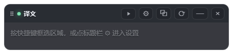
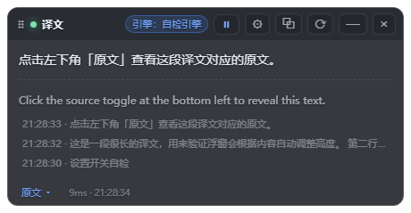
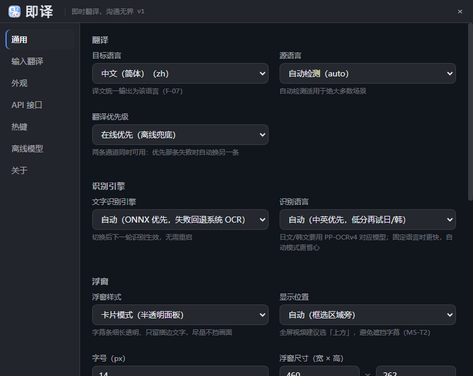
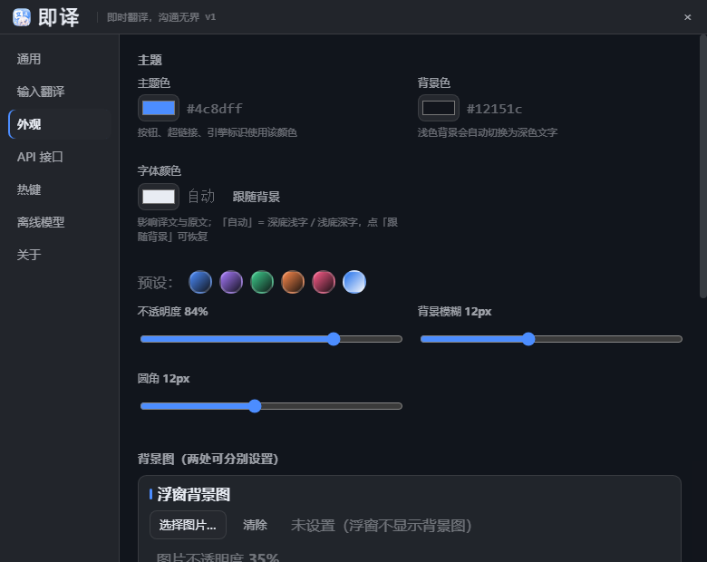
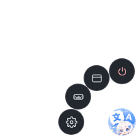

# 即译 · 桌面翻译助手

> 在屏幕上框一段字，浮窗立刻给出译文。**可选联网 API，也可以完全离线**（本机 GGUF 模型），
> 截图只取你框的那一块，屏幕内容不外传。



一个跨平台的桌面小工具，专治「游戏 / 视频 / 图片 / 报错弹窗里的字复制不了」。

- 框选即翻译：`Ctrl+Shift+T` 拖一个矩形，松手出译文
- 字幕条模式：细长透明条，只留描边文字，尽量不挡游戏画面，可拖边缘改宽高
- 离线可用：内置 llama.cpp 运行时，配好 GGUF 就能断网翻译
- 联网可换：任意 OpenAI 兼容接口（DeepSeek / OpenAI / 通义 / 自建网关），Key 加密存在本机
- 识别：ONNX PP-OCRv4（中英 / 日 / 韩）+ Windows 内置 OCR 兜底，标点与中英混排做了专门收敛

## 下载

到 [Releases](../../releases) 页面按平台取包，解压即用（免安装，不需要管理员权限）。

| 平台 | 包 | 大小 | 说明 |
| --- | --- | --- | --- |
| Windows 10/11 x64 | `jiyi-1.1.0-portable-win-x64-nomodel.zip` | ≈ 212 MB | 解压后双击 `即译.exe`；不含离线模型 |
| macOS 11+（Apple Silicon） | `jiyi-1.1.0-macos-arm64.zip` | ≈ 144 MB | 解压得到 `即译.app`，拖进「应用程序」 |
| macOS 11+（Intel） | `jiyi-1.1.0-macos-x64.zip` | ≈ 150 MB | 同上，Intel 机型用这个 |
| Linux x64（glibc 2.28+） | `jiyi-1.1.0-linux-x64.tar.gz` | ≈ 154 MB | 解压后运行 `./即译.sh` |

所有包都**不含**离线翻译模型（原因见下）。需要离线时按「离线模型」一节自行放 GGUF，
各平台还要自备对应平台的 `llama-server`。

> 为什么默认提供不含模型的包：内置模型是腾讯混元社区许可，**不得分发到欧盟 / 英国 / 韩国**，
> 公开仓库挂全球可下载的包会与该许可冲突。需要离线时请自己在本地获取模型（见下）。

### 首次打开

- **Windows**：若出现「Windows 已保护你的电脑」→ `更多信息` → `仍要运行`（未签名程序的正常提示）。
- **macOS**：包未做 Apple 公证，首次请**右键 → 打开**；若提示「已损坏」，在终端执行
  `xattr -dr com.apple.quarantine /Applications/即译.app`。首次启动还需在
  「系统设置 → 隐私与安全性 → 屏幕录制」里勾选「即译」，否则框选是黑屏。
- **Linux**：用随包的 `即译.sh` 启动（解压出来的 `chrome-sandbox` 不是 root 所有，
  Chromium 沙箱不可用，脚本里带了 `--no-sandbox`）。缺库时装：
  `libnss3 libatk-bridge2.0-0 libgtk-3-0 libgbm1 libasound2`。想恢复沙箱见 `使用说明-Linux.txt`。

## 快速开始

1. 解压并启动（Windows 双击 `即译.exe`，macOS 打开 `即译.app`，Linux 运行 `./即译.sh`）。
   首次会走引导：选目标语言 → 下一步 → 完成。
2. 按 `Ctrl+Shift+T`（macOS 为 `⌘⇧T`），在屏幕上拖一个矩形，松手即可看到译文浮窗。

常用热键（可在设置页改）：

| 动作 | 默认热键 |
| --- | --- |
| 框选翻译 | `Ctrl+Shift+T` |
| 重译上次区域 | `Ctrl+Shift+R` |
| 暂停 / 继续定时翻译 | `Ctrl+Shift+P` 或浮窗 `⏸`、`Esc` |
| 显示 / 隐藏浮窗 | `Ctrl+Shift+Y` |
| 收起为悬浮球 | `Ctrl+Shift+U` |

完整说明见 [docs/使用说明.md](docs/使用说明.md)。

## 界面

| 译文浮窗（原文默认收起） | 字幕条模式（视频 / 游戏） |
| --- | --- |
|  |  |

| 设置 · 通用 | 设置 · 外观 |
| --- | --- |
|  |  |

悬浮球：鼠标移上去，选项以圆形气泡绕球展开。



## 离线模型（可选）

1. 到 ModelScope 下载 `HY-MT1.5-1.8B-Q4_K_M.gguf`（Tencent-Hunyuan/HY-MT1.5-1.8B-GGUF）。
2. 放进模型目录（没有就新建）：
   - Windows：程序目录的 `userdata\models\`
   - macOS：`~/Library/Application Support/desktop-translator/models/`
   - Linux：`~/.config/desktop-translator/models/`
3. 再把**对应平台**的 `llama-server` 放进 `runtime/llama/`
   （Windows 在程序目录；macOS 在 `即译.app/Contents/Resources/runtime/llama/`；
   Linux 在解压目录的 `resources/runtime/llama/`）。发布包不含它，原因见 `runtime/README.txt`。
4. 设置页「离线模型」里能看到模型即可；引擎标识显示「离线模式」代表走本机模型。

没有模型时也可以用：设置 →「API 接口」→ 添加一个 OpenAI 兼容接口，填 Key 就能联网翻译。

## 从源码构建

需要 Node.js 24+、pnpm；Windows 打包另需 `csc.exe`（.NET Framework 4），
macOS / Linux 包用 Python 3 交叉打包（无需在目标平台上构建）。

```powershell
cd 项目代码
pnpm install
node scripts/launch.js          # 开发态启动
node scripts/smoke.js           # 应用自检（截图 + report.json）
node scripts/package-win.js     # Windows：dist\win-x64 与免安装 zip
node scripts/package-release.js --no-model      # Windows 可分发发布包
python scripts/build-cross.py --target all      # macOS(arm64/x64) + Linux 包
node 项目测试\run-all.js        # 全量测试（单元 / 集成 / OCR 精度）
```

架构与开发约定见 [项目代码/README.md](项目代码/README.md) 与 [项目代码/AGENTS.md](项目代码/AGENTS.md)。

## 隐私

- 截图只发生在你框选的矩形内，不上传、不落盘、不留日志正文。
- 联网翻译只把**识别出的文字**发给你自己配置的接口；没有任何遥测 / 统计 / 崩溃上报。
- 配置文件在各自的数据目录（见上），API Key 以 AES-256-GCM 加密（机器指纹派生），界面只显示掩码。

## 已知限制

- 托盘图标在部分 Windows 会话里注册不上（系统通知区域限制），此时会自动显示悬浮球作为常驻入口。
- 未签名的可执行文件会触发 SmartScreen（Windows）/ Gatekeeper（macOS）。
- 悬浮窗置顶、全局热键在 **Wayland** 下受限：Chromium 无法全局抓键盘、`alwaysOnTop` 也可能被合成器忽略，
  建议在 X11 会话或 XWayland 下使用。
- Windows 内置 OCR 兜底（WinRT）只在 Windows 上可用；macOS / Linux 用 ONNX OCR（中英日韩）或 Tesseract。
- 韩文识别模型不吐空格；自动识别语言对「中日韩混排同一屏」会取主导语言。
- 内存：离线模型常驻约 2.0–2.2 GB（空闲 10 分钟自动卸载，可关）。
- **macOS / Linux 包由 Windows 端交叉组装（官方 Electron 运行时 + 应用负载），未在真机验证过**，
  遇到问题请开 issue 附 `userdata/logs/` 下的日志。

## 许可

- 本项目代码：见仓库内各文件的说明；第三方组件与许可清单见发布包 `licenses\第三方组件与许可.txt`。
- **内置离线模型 HY-MT1.5-1.8B**：Tencent HY Community License。分发时须随附许可副本与 NOTICE；
  不得暗示腾讯背书；**不得分发到欧盟 / 英国 / 韩国**；月活超 1 亿需另行申请。
- OCR 模型（PP-OCRv4，Apache-2.0）、onnxruntime（MIT）、llama.cpp（MIT）、Electron（MIT）见许可清单。
